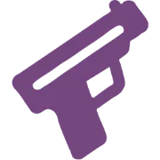
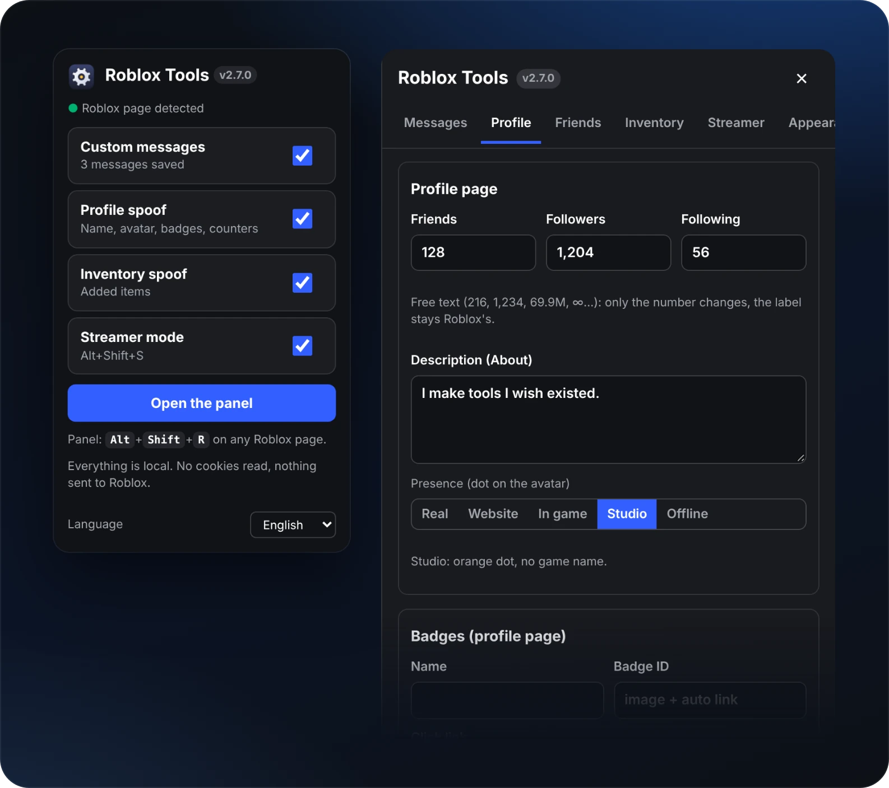
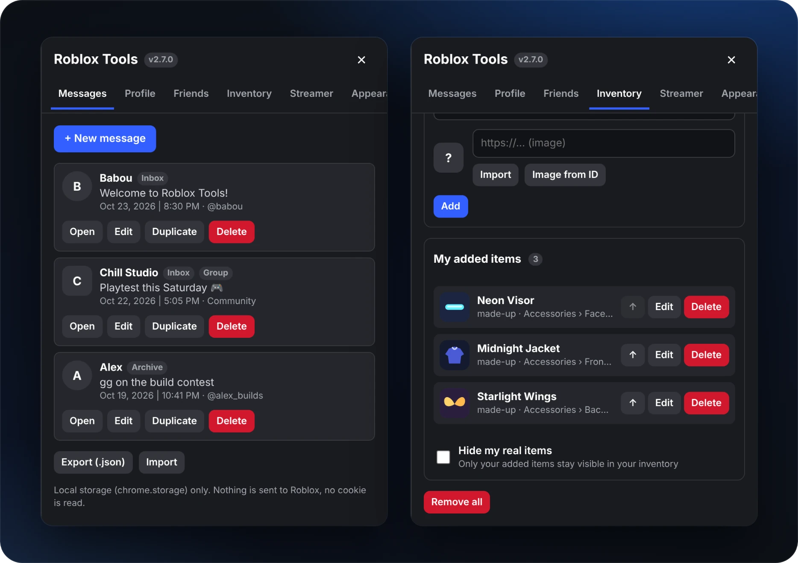
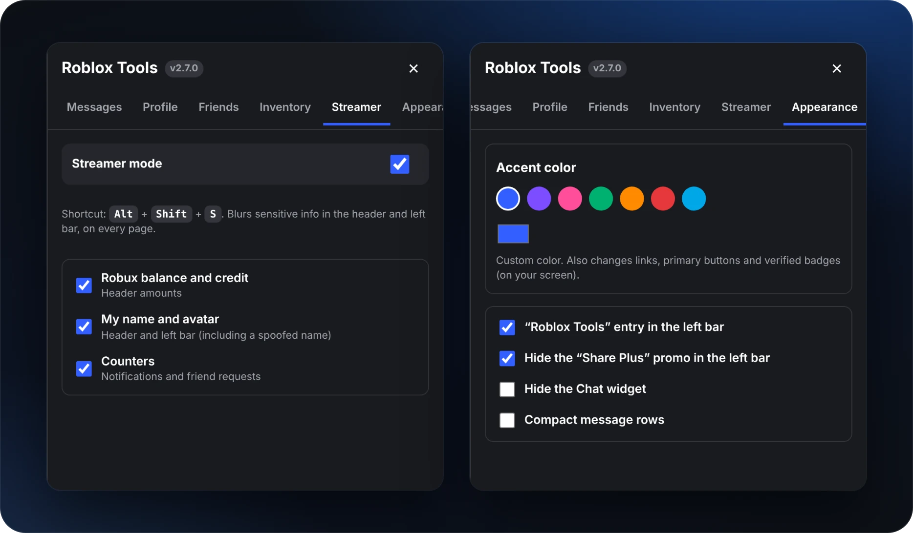

<!-- GitHub profile README | baboub2013-bot -->

<div align="center">

  

  <p><strong>I make tools I wish existed.</strong></p>

  <p>Browser extensions, Roblox projects, Minecraft experiments, and whatever I feel like building next.</p>

  <p>
    <a href="https://www.youtube.com/@Babou.223"></a>
    <a href="https://guns.lol/babou.223"></a>
    <a href="https://www.patreon.com/cw/Babou762"></a>
    <a href="https://buymeacoffee.com/baboukindadev"></a>
  </p>

</div>

## Hey, I'm Babou 👋

I bounce between browser extensions, Roblox Studio, and Minecraft projects. I like taking an idea for a feature and seeing if I can actually make it work.

I build solo, mess around with interfaces a lot, and somehow always end up spending an hour fixing one button. I also use Python now and then for small scripts.

## What I'm building

### 🧩 Roblox Tools

A browser extension project with custom Roblox profile and inventory interfaces, appearance settings, and a streamer mode that hides on-screen account details.

**JavaScript · HTML · CSS**

*Personal project, not affiliated with Roblox.*

<p align="center">
  
</p>

<details>
  <summary><strong>View more screenshots</strong></summary>
  <br />
  <p align="center">
    
    
  </p>
</details>

### 🎮 Roblox Studio

Working with **Luau** to make interactive UIs, admin systems, and gameplay experiments. I spend a lot of time on the details, from how a button looks to what it actually does.

### ⛏️ Minecraft

Experimenting with **Java** and **Paper**: server commands, dialogue-style menus, player utilities, and combat/teleport systems.

## Languages & tools

<div align="center">

  <strong>Languages & web</strong>

  <br />
  

  <br /><br />
  <strong>Tools & platforms</strong>

  <br />
  

</div>

## On my GitHub

**[Iris.ts](https://github.com/baboub2013-bot/Iris.ts)** is my Vencord userplugin for local Discord profile customization.

**[SpearTech](https://github.com/baboub2013-bot/SpearTech)** is a Meteor Client addon with Minecraft spear-related features and utilities.

The pinned repositories below have the code and project details.

## 🔎 Transparency

I sometimes use AI to help with debugging, understanding errors, or exploring possible fixes. Here's how I handle it:

- **AI disclosures:** If AI helps create or meaningfully modify a file, I add a comment at the top explaining what it was used for and why. If the assistance affects a whole project, I also note it in that project's README.
- **Review and testing:** I review AI suggestions myself and test changes before treating them as finished. AI-generated output isn't automatically correct.
- **Credits:** I aim to credit outside code, resources, and contributors instead of presenting their work as entirely mine.
- **Privacy:** I avoid sharing credentials, private information, or sensitive project data with AI tools.
- **Corrections:** If I miss a disclosure or credit, I'll correct it when I notice.

**AI is a tool I sometimes use, not a replacement for understanding the code.**

## How it usually goes

```text
have an idea
    ↓
make a prototype
    ↓
break something (probably)
    ↓
figure out why
    ↓
fix it, improve it
    ↓
ship it
```

<div align="center">

  <sub>Thanks for checking out my projects. 👋</sub>

  <br /><br />
  

</div>
